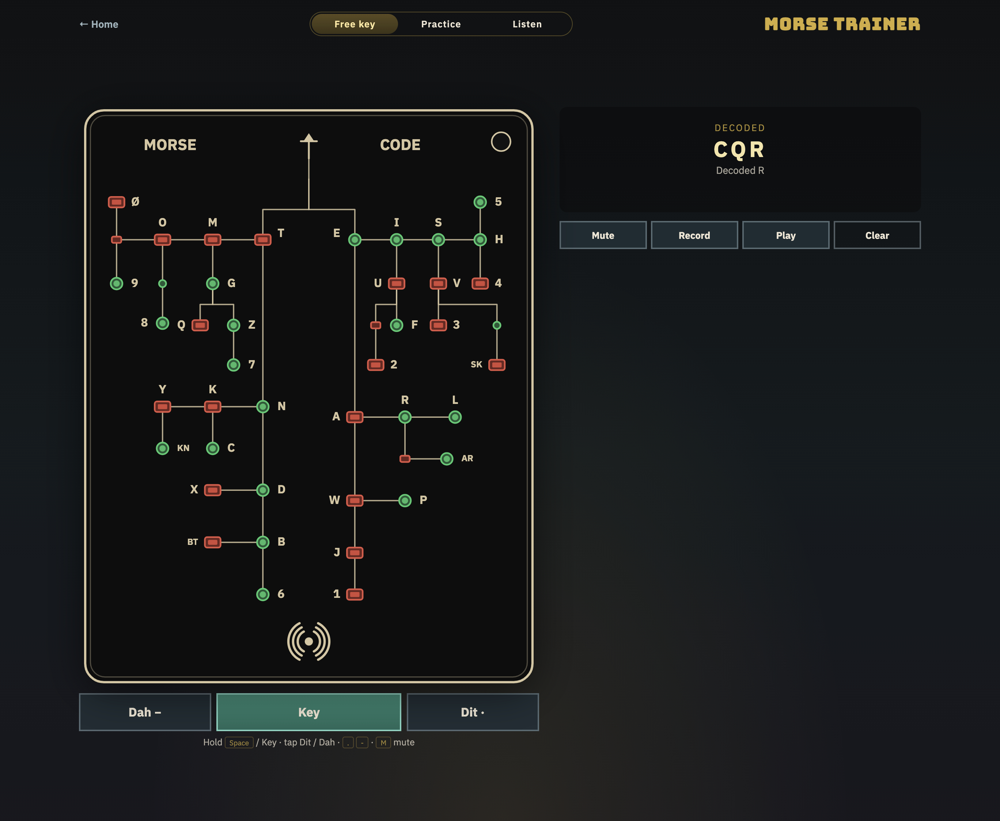
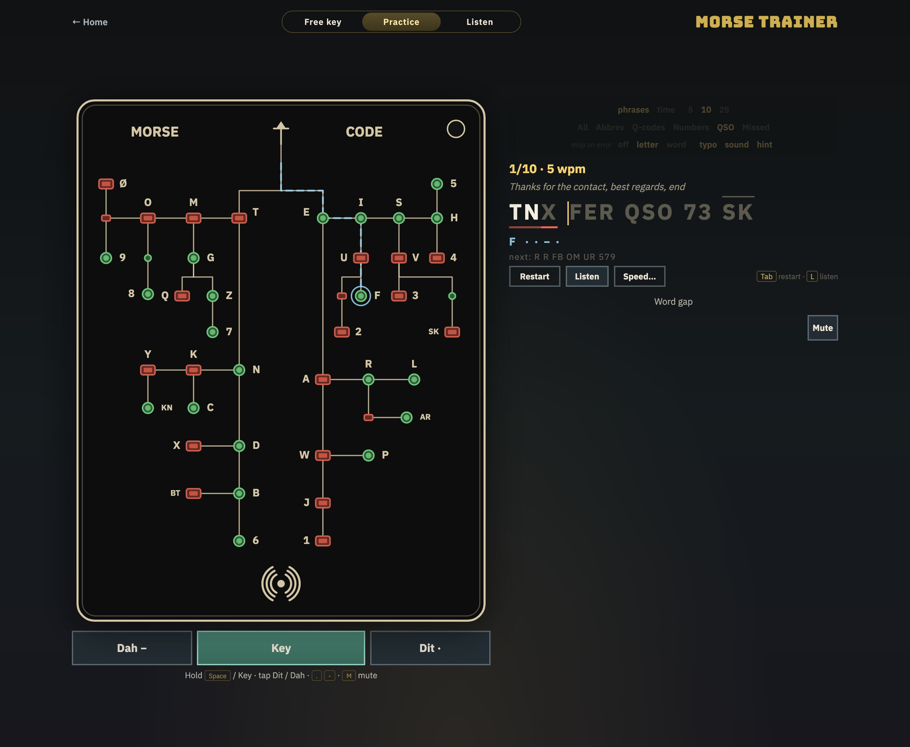
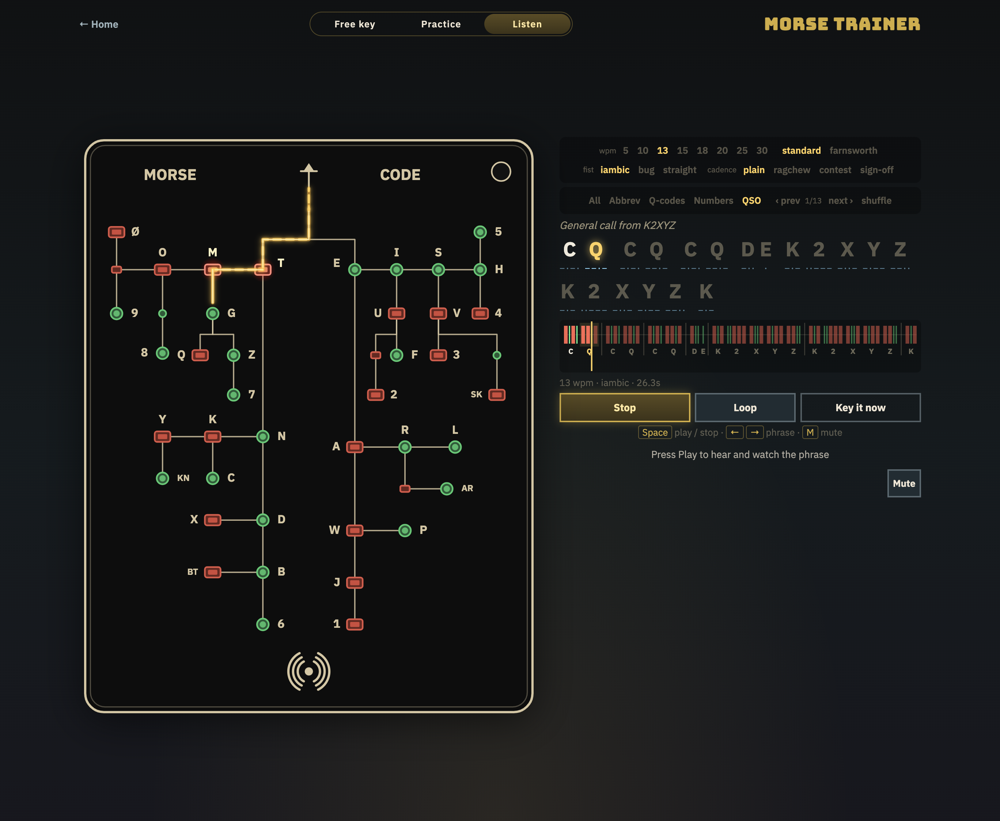

# Morse Code Trainer

[](https://morse.wildideazone.com/)

An interactive dichotomous Morse chart (Trainer Card Pro style): hold **Space** or **Key** for dits/dahs, watch the LED path light up, hear CW beeps, mute for silent practice, use Record / Play to audit timing, switch to **Practice** for Monkeytype-style CW shorthand drills, or **Listen** to hear phrases keyed for you. Mobile-friendly.

Hosted as a static site on GitHub Pages. Part of [Wild Idea Zone](https://www.wildideazone.com/): see the [project page](https://www.wildideazone.com/projects/morse-code-trainer) and [more projects](https://www.wildideazone.com/projects).

## Use it

- **Live:** [morse.wildideazone.com](https://morse.wildideazone.com/)
- **Local:** from the repo root run `python3 -m http.server 8080` and open `http://localhost:8080`

## Screenshots

**Free key** — key on the dichotomous chart and watch the decoded message build up.



**Practice** — send CW shorthand drills with per-character feedback and a hint path on the card.



**Listen** — hear a phrase keyed while the card lights each path and the rhythm strip tracks the playhead.



## Controls

| Action | Input |
| --- | --- |
| Key (hold) | **Space** or on-screen **Key** (short = dit, long = dah) |
| Dit / Dah (tap) | **.** / **-** or on-screen **Dit** / **Dah** |
| Mute / silent LED mode | **M** or **Mute** |
| Record / stop recording | **R** or **Record** |
| Play / stop playback | **P** or **Play** |
| Clear message & buffer | **Clear** |

Short presses are dits (right / circle branch); longer presses are dahs (left / rectangle branch). Pause to commit a letter into the decoded message. The card covers A–Z, digits 0–9 (zero is drawn slashed, `Ø`), and the prosigns **AR**, **BT**, **KN**, **SK**; small unlabeled pads are intermediate codes on the way to a digit or prosign.

## Practice mode

Switch the toggle from **Free key** to **Practice** for Monkeytype-style send drills built from common CW shorthand: abbreviations (CQ, DE, TNX, FB…), Q-codes (QTH, QRZ, QSL…), numbers and reports (73, 599, 5NN…), and full QSO lines. Each phrase shows its meaning above the target text.

- Key the phrase with the same inputs as Free key. Decoded characters turn **white** when correct and **red** when wrong (with the keyed character shown underneath when **typo** is on). Extra characters show as faded red; characters skipped by an early word gap are underlined.
- A word advances automatically once it is keyed correctly; otherwise the word gap (pause) moves on.
- Prosigns are keyed as one character with no letter gap and shown with an overline.

| Setting | Options |
| --- | --- |
| Test mode | **phrases** (5 / 10 / 25) or **time** (30s / 60s / 120s) |
| Category | All, Abbrev, Q-codes, Numbers, QSO, **Missed** (words you previously got wrong) |
| Stop on error | **off**, **letter** (wrong characters are rejected), **word** (a wrong word is cleared at the word gap to re-key) |
| Feedback | **typo** indicator, error **sound**, **hint** (next character's pattern plus a ghost path on the card) |

Press **Listen** (or **L**) to hear and watch the current phrase keyed before you send it; **Speed…** opens the listen settings (shared with Listen mode) and an **auto-listen** toggle that plays each new phrase once. Keying is blocked while it plays, and listening time does not count against your WPM.

The timer starts on the first key press. Results show WPM (correct characters ÷ 5 per minute), accuracy, raw WPM, character breakdown, time, your personal best for that mode, a WPM-over-time chart with red ✕ marks at error seconds, and the characters you missed with their patterns. Press **Tab** / **Enter** or **Restart** for a new run. Settings, personal bests and missed words are saved in `localStorage`.

## Listen mode

Pick **Listen** in the mode toggle to hear and see phrases keyed for you. The CW tone plays, the card lights each dit/dah path, the current character glows with its dit/dah pattern underneath, and a rhythm strip draws every element to scale (green dits, red dahs) with a moving playhead.

| Setting | Options |
| --- | --- |
| Speed | 5, 10, 13, 15, 18, 20, 25, 30 WPM |
| Timing | **standard** (PARIS 1-3-7 spacing) or **farnsworth** (characters at 18 or 20 WPM, gaps stretched to the chosen speed using the ARRL formula) |
| Fist | **iambic** (machine-perfect), **bug** (crisp dits, long hand-made dahs), **straight** (human swing and jitter, repeatable per phrase) |
| Cadence | **plain**, **ragchew** (grouped repeats, pauses before DE and around BT), **contest** (cut numbers 9→N, 0→T, 1→A, tight spacing), **sign-off** (adds the dit dit after SK) |

Choose a category and step through phrases with **‹ prev** / **next ›** / **shuffle** (or **←** / **→**). **Space** plays and stops, **Loop** repeats the phrase, and **Key it now** jumps to Practice with the same category.

## Layouts

- **Phone / narrow** (under 900px wide): the compact single-column layout, with the card sized per mode.
- **Laptop** (900px+ wide, 560px+ tall): two columns. The card and key controls stay pinned on the left, and the readout, Practice drills, or Listen player fill the right.
- **Wide screen** (1440px+): adds a third column, a **code chart** of A–Z, 0–9, and prosigns. It highlights each character once you have keyed it, the character being played back, and (in Practice) the next character to send. Click any row to hear it; a rhythm strip at the top of the chart draws its dits and dahs to scale with a moving playhead. Clicks are ignored during a Practice run.

## Project layout

```
index.html
src/
  main.js       # boot: trainer, practice, listen, code chart, mode toggle
  styles.css
  assets/
    morse-card-reference.jpg   # tight crop reference for canvas card
    wild-idea-zone.svg         # Wild Idea Zone logo (favicon + header link)
  morse/
    tree.js     # dichotomous Morse tree (letters, digits, prosigns)
    audio.js    # Web Audio CW tone + error beep
    decoder.js  # dit/dah + letter/word gap timing
    board.js    # canvas vector PCB card + LED glow + hint path
    trainer.js  # keying, decode, record/playback, practice hooks
    drills.js   # CW shorthand / QSO phrase bank
    practice.js # Monkeytype-style send practice + results
    sender.js   # listen timing: PARIS/Farnsworth, fists, cadences
    player.js   # phrase playback (tone + card) + rhythm strip
    listen.js   # Listen mode + shared listen settings
    reference.js # wide-screen code chart with live highlight
.github/workflows/deploy.yml
```

## GitHub Pages

1. Merge to `main`
2. Repo **Settings → Pages → Source: GitHub Actions**
3. The deploy workflow publishes the static site

### Custom domain (`morse.wildideazone.com`)

DNS lives on Cloudflare: `morse` is a CNAME to `dwisnowski.github.io`, **DNS only** (grey cloud) so
GitHub can issue the HTTPS certificate. The workflow deploys via Actions, so the domain is set in
**Settings → Pages → Custom domain** (a `CNAME` file in the repo is ignored), then enable
**Enforce HTTPS** once the certificate is ready.

Originally built inside [boing-boing](https://github.com/dwisnowski/boing-boing).
